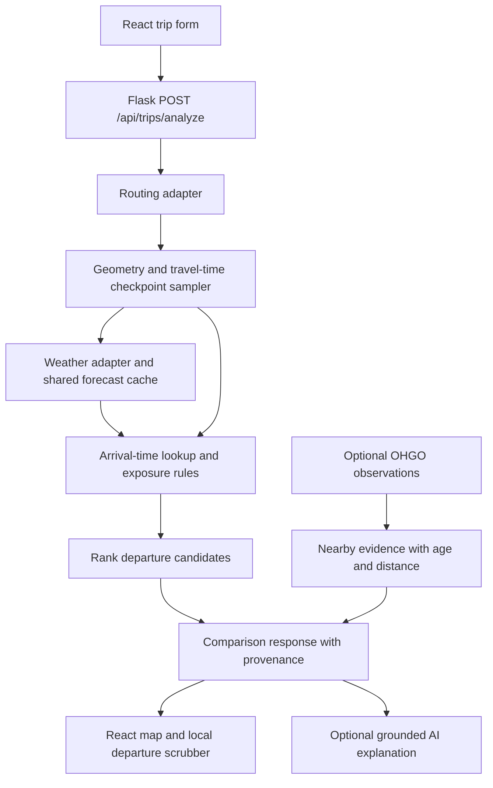

# Road-trip weather corridor: hackathon MVP

Prepared October 24, 2026. This document records the proposed scope and architecture.

Implementation update: the core planner, live OSRM/Open-Meteo integration, optional Mapbox adapter, checkpoint map, departure scrubber, exposure comparison, and labeled simulated scenario are now implemented. Setup and current limitations are documented in the root README. Live Columbus–Cleveland analysis and browser interactions were verified, and 29 automated tests plus the production build passed. Mapbox requires a token and has not been tested against a live account. The offline scenario is synthetic rather than a captured provider forecast. OHGO, radar, and AI integrations remain follow-up work.

## Product promise

**See the forecast where you will be when you get there, then compare when to leave.**

The demo should answer one question: “Within my departure window, which departure has the lowest forecast weather exposure on this trip?” Recommend a window, with the selected candidate time, rather than claiming an exact safest minute.

## Recommended scope

Start with Ohio trips lasting roughly 1–4 hours, a departure window up to two hours wide, and trips finishing within the available short-range forecast. Use Columbus → Cleveland as the initial integration corridor; choose a different corridor for the presentation if the live forecast has no meaningful variation. Do not invent a storm in live mode.

### Must ship

1. Origin, destination, and earliest/latest departure inputs. A preset corridor is sufficient before geocoding is integrated.
2. One real driving route with geometry and travel-time annotations. Support a second provider-returned route if available; do not require alternatives to exist.
3. Checkpoints at the origin, every 15 minutes of cumulative travel time, and the destination. Each has coordinates, distance traveled, road bearing, and estimated arrival time.
4. Forecast conditions matched to checkpoint arrival times: precipitation, visibility, wind/gusts, and air temperature. Label unavailable variables explicitly.
5. A departure scrubber in five-minute steps. Route colors, checkpoint arrival times, exposure totals, and the recommendation update together.
6. A checkpoint detail panel showing values, units, valid time, source, retrieval time, and reasons for its exposure label.
7. A comparison between “leave at the earliest allowed time” and the recommended departure: departure, arrival, high-exposure minutes, and weather drivers.
8. An explicitly labeled recorded scenario for reliable presentation and reproducible development, separate from live data.

Use labels such as **lower exposure / caution / higher exposure / unknown**, plus text or patterns so color is not the only signal. Lower exposure does not establish that a road is safe.

### Stretch, in order

1. A second route and comparison of arrival versus exposure.
2. Nearby OHGO road-weather stations with observation timestamps, distance to checkpoint, and measured pavement temperature where present.
3. Official NWS alerts intersecting route geometry. Current alerts are context; do not assume their present geometry predicts a storm's future position.
4. A grounded AI trip explanation generated from the calculated results.
5. One or two corridor camera snapshots with an optional visible-condition classifier.

### Defer

- Direct HRRR GRIB ingestion, forecast reflectivity tiles, and animated radar overlays.
- A trained pavement-freezing probability model or hydroplaning probability.
- Forecasting traffic slowdown before it happens.
- Continuous navigation, GPS rerouting, notifications, national camera integrations, and account-management work.

These additions each introduce a separate data or validation problem. Finish the departure comparison before adding them.

## Data providers and decisions

| Need | MVP choice | Decision and limit |
| --- | --- | --- |
| Route and travel times | Mapbox Directions API, driving-traffic profile | Full GeoJSON geometry and per-edge duration annotations; alternatives when returned. Token and account setup required. Traffic prediction already exists in navigation APIs, so differentiate on weather at arrival, not an assertion that other apps only use current traffic. |
| Map rendering | Mapbox GL JS with the same provider | Keep one map/provider integration for the hackathon. Retain required attribution. |
| Weather | Open-Meteo NOAA GFS/HRRR API | Prefer the explicit HRRR CONUS 15-minute model for the supported horizon. Validate requested variables before building the UI; document any hourly interpolation or model fallback. This supplies point forecasts, not radar imagery. |
| Weather fallback | NWS hourly/grid forecast | Optional degraded mode with its actual hourly cadence. Never silently label it a 15-minute forecast. |
| Road conditions | OHGO weather-sensor-sites | Optional local observations of pavement and atmosphere. Registration/API key required; observations are not future pavement forecasts. |
| Cameras | OHGO cameras | Optional snapshots only. A nearby camera may show a different road direction or surface; retain its location and age. |

Provider behavior was checked against the official documentation linked below. Keys, account access, actual variable availability, and live route/weather responses still need an implementation spike; this is not a completed integration test. Check current account terms and quotas during setup rather than relying on a presumed free allowance.

Open-Meteo documents approximately 3 km HRRR coverage and an 18-hour window for its 15-minute product. Not every variable requested at 15-minute intervals is necessarily native at that cadence; some are interpolated. NOAA describes longer hourly forecasts on extended HRRR cycles. Restrict the MVP to the shortest valid horizon of the selected fields. Never extend a series by carrying its last value forward without marking the result unavailable.

OHGO documents current roadside observations including pavement temperature, generally collected every five minutes. Use each sensor's actual last-update timestamp, not the documented collection frequency, to determine freshness.

## Architecture

Reuse the existing React/Vite frontend, Flask backend, and Postgres installation. Keep the planner usable without signing in. Existing auth may remain separate; the weather engine should not depend on account storage being available.

The backend fetches forecast time series once for the unique checkpoint locations over the full departure-plus-trip window. It then evaluates departure candidates against the same snapshot. The scrubber selects a precomputed candidate in memory; it does not call a weather provider for every drag event.

For the first version, freeze route geometry and baseline edge travel times across the departure window and disclose that simplification. A stretch version obtains departure-specific route travel times and rebuilds checkpoints. Do not imply weather-dependent traffic prediction in either version.

### Computation

1. Sum annotated road-edge durations. Interpolate coordinates inside the edge that crosses each 15-minute checkpoint; do not spread points uniformly by straight-line distance.
2. For candidate departure `d` and cumulative route offset `tau_i`, compute `arrival_i = d + tau_i`. Store UTC internally and include an IANA zone for display, initially `America/New_York`.
3. Match weather by its valid interval, not retrieval time. Respect each variable's semantics: temperature is an instantaneous value, while precipitation can be an accumulation over a preceding interval. Convert to a comparable intensity using that interval's duration; do not treat mm/15 min as mm/hour.
4. Compute local road bearing from nearby geometry vertices. Estimate crosswind component as `abs(wind_speed * sin(wind_from_direction - road_bearing))`, with angles converted to radians. The same projection applied to gusts is only an approximation when gust direction is unavailable.
5. Apply explicit, versioned exposure rules. Rain, low visibility, and crosswind are separate indicators. Wet conditions near freezing may produce a **possible freezing conditions** flag, not a calibrated ice probability. Atmospheric wind is not a measurement of wind at a particular bridge or road cut.
6. Aggregate indicators into a conservative ordinal class and explanatory reasons. Missing required fields produce **unknown**, never a zero-risk value. Initial thresholds are demonstration heuristics, not validated driving limits; tune and version them using recorded scenarios before the demo.
7. For each interval between checkpoints, use the worse available endpoint class and weight by interval duration. Report the resulting high-exposure minutes as a sampled estimate. Fifteen-minute sampling can miss a short or local hazard; denser spatial sampling is the first fidelity upgrade.
8. Rank complete-data candidates by worst exposure class, then high-exposure minutes, then duration-weighted exposure, then earliest arrival. Waiting is reflected in arrival time. If all candidates have higher exposure, say so. Do not force a positive recommendation.
9. Also evaluate arrival offsets of minus/plus 15 minutes as an ETA sensitivity check. If the chosen candidate changes substantially, mark the recommendation sensitive to arrival timing. This is a scenario check, not a statistical confidence interval.
10. Group adjacent candidates with the same best class and similar exposure into a recommended window. State the grouping tolerance in the scoring configuration. Incomplete-data candidates should not beat complete-data candidates by treating unknown conditions as clear.

For scale: an illustrative three-hour route has 13 checkpoints including both endpoints. A two-hour departure window at five-minute increments has 25 candidates. Two such routes produce 650 checkpoint-time lookups, not 650 weather HTTP requests. This arithmetic illustrates the caching design; it is not a latency benchmark.

### API contract

`POST /api/trips/analyze`

Request fields:

- `origin`, `destination`: coordinates in the first integration; geocoded place selections later. GeoJSON coordinate order is longitude, latitude.
- `departureStart`, `departureEnd`: ISO timestamps with explicit offsets.
- `timeZone`: IANA identifier for display.
- `includeAlternatives`: boolean.
- `dataMode`: `live` or `recorded`; recorded mode must remain visibly labeled in every response and view.

Response fields:

- `analysisId`, `generatedAt`, `dataMode`, `scoringVersion`, `coverageStatus`.
- `sources[]`: provider, model where exposed, retrieval time, valid range, native/returned cadence where known, and warnings. Do not fabricate a model issue time when the provider does not expose it.
- `routes[]`: id, geometry, distance meters, baseline duration seconds, and checkpoint definitions.
- `candidates[]`: route id, departure, arrival, checkpoint forecast matches, exposure reasons/classes, estimated exposure minutes, missing-data flags, and ETA sensitivity.
- `recommendation`: route id, candidate id, window, rationale fields, or a reason no recommendation can be made.
- `observations[]`: optional sensor/camera id, coordinates, observed time, fetched time, distance from route, and available measurements. Keep observations distinct from forecast values.

Reject malformed coordinates, reversed windows, unsupported trip lengths/horizons, and excessive candidate counts. Return clear upstream timeout and partial-data statuses. Choose candidates only inside the requested departure window. Never replace failed live data with recorded data without changing and displaying `dataMode`.

### Storage and caching

No new database tables are needed to prove the core interaction. Use a bounded server-side cache for this single-process demo and keep recorded scenarios in versioned JSON files. Do not persist every computed candidate as a separate row.

If saved trips or persistence become useful, add:

- `trip_analyses`: request, route snapshot, generation time, scoring version, and optional user id.
- `forecast_snapshots`: provider/model, provider grid coordinate or location, fetched time, valid interval, units, cadence, and original payload.
- `road_observations`: provider/device id, location, observation timestamp, fetched time, and payload.

Cache by provider, model, location/grid cell, requested fields, and forecast time range. Preserve real provider grid positions when supplied; avoid arbitrary coordinate rounding across different terrain. Start with a configurable 10-minute application cache lifetime for weather and retain its original retrieval age. This lifetime is an implementation choice, not a provider update guarantee. Bound memory, deduplicate concurrent requests, and use timeouts with limited retries. Keep secrets in backend environment variables; a browser map token should be scoped appropriately.

## AI: the defensible role

The spatio-temporal join and departure optimization do not need an LLM. They should be deterministic and inspectable.

The lowest-cost AI feature is a constrained explanation using structured checkpoint evidence: what changes between departures, where exposure is concentrated, and which inputs are missing. Require referenced checkpoint ids; validate numerical claims against the response and use a template if the model fails. The explanation cannot change scores or invent safer conditions.

If computer vision is central to judging, add one focused feature: classify visible pavement as dry-looking, wet-looking, snow-covered, or indeterminate, with capture time and camera location. Keep this as current supporting evidence. A photo cannot reliably establish black ice, determine future pavement conditions, or prove that a radar return is false. Model self-reported confidence is not a calibrated probability. Training a localized speed-degradation model requires historical matched weather/traffic outcomes and belongs after the hackathon.

## Implementation order and completion gates

Suggested order for a roughly 24-hour build; timing depends on team size and API access.

| Stage | Deliverable | Completion gate |
| --- | --- | --- |
| First 2 hours | Provider spike and a pinned recorded scenario | One real route with durations, one real checkpoint forecast with units/times, confirmed keys, and explicit fallback behavior. |
| Hours 2–6 | Pure checkpoint sampler, time lookup, and scorer | Recorded inputs produce stable outputs; origin/destination and interval boundaries are correct. |
| Hours 6–12 | Map, checkpoint inspector, and departure scrubber | Scrubbing changes the chosen candidate, map classes, arrivals, and comparison consistently with no provider requests. |
| Hours 12–16 | Live analysis endpoint and caching | Live trip works; stale, missing, out-of-horizon, timeout, and no-alternative cases remain clear. |
| Hours 16–20 | Recommendation and optional OHGO evidence or AI explanation | Every claim traces to a checkpoint or timestamped observation; optional integrations cannot block the main path. |
| Final 4 hours | Demo rehearsal and fixes | A reproducible recorded comparison, one live run, and an honest account of forecast resolution and limitations. |

If work is split across teammates: frontend owns map/scrubber/details; backend owns routing/weather/cache; the algorithm owner owns checkpoint timing/scoring/scenarios. Agree on the response shape before parallel implementation. No additional agents or team messages have been created by this plan.

Proposed files fit the existing repo:

- `Frontend/src/TripPlanner.jsx`, `RouteMap.jsx`, `DepartureScrubber.jsx`, `CheckpointPanel.jsx`.
- `Backend/providers/routing.py`, `weather.py`, optional `ohgo.py`.
- `Backend/corridor.py` for pure checkpoint and arrival calculations.
- `Backend/exposure.py` for versioned rules and ranking.
- `Backend/fixtures/` for recorded source responses with retrieval/valid times.

The existing `Backend/app.py` initializes Postgres at module import. Move that startup dependency out of the anonymous planner path or ensure the configured database is available; otherwise a database outage prevents the weather demo from starting even when weather data is accessible.

### Essential verification

- A route with unequal edge speeds places checkpoints by travel time, including inside an edge and at the destination.
- Equivalent offset timestamps produce the same UTC lookup; daylight-saving transitions are unambiguous.
- Precipitation accumulation intervals, unit conversion, and missing time slots are handled correctly.
- Parallel wind has approximately zero projected crosswind; perpendicular wind has the full component; bearings wrap at 360 degrees.
- A recorded moving-weather scenario produces a different exposure pattern after departure changes, with all displayed times consistent.
- Unknown, stale, partial, and out-of-horizon forecasts never render as lower exposure by default.
- A tied score prefers earlier arrival; an all-higher-exposure set does not claim a clear route; candidate times stay inside the window.
- Fifteen-minute timing perturbations can visibly change a sensitive recommendation.

### Presentation sequence

Show the recorded corridor and its earliest departure. Select a higher-exposure checkpoint and show arrival time plus source values. Move departure later and show the changed checkpoint conditions. Present the recommended window and arrival tradeoff. Switch to live mode only when providers succeed. Label all recorded material and make no claim of measured safety improvement.

## Official references

- [Mapbox Directions API: geometry, annotations, alternatives, and departure-aware traffic](https://docs.mapbox.com/api/navigation/directions/)
- [Open-Meteo NOAA GFS/HRRR API: models, fields, cadence, and valid intervals](https://open-meteo.com/en/docs/gfs-api)
- [NOAA HRRR operational description and forecast cadence](https://emc.ncep.noaa.gov/emc/pages/numerical_forecast_systems/hrrr.php)
- [NWS forecast/grid API documentation](https://www.weather.gov/documentation/services-web-api)
- [OHGO API registration](https://publicapi.ohgo.com/docs/registration)
- [OHGO road-weather sensor documentation](https://publicapi.ohgo.com/docs/v1/weather-sensor-sites)
- [OHGO camera documentation](https://publicapi.ohgo.com/docs/v1/cameras)
